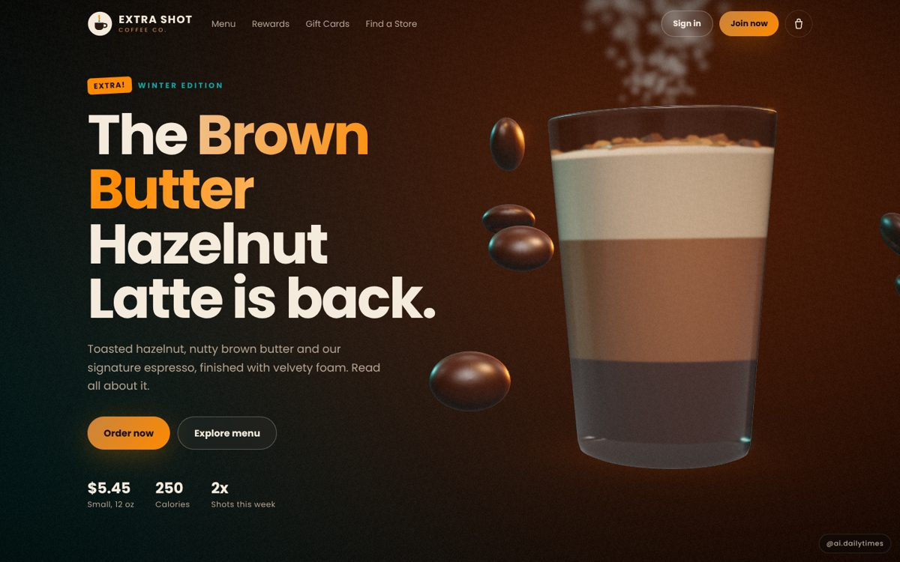
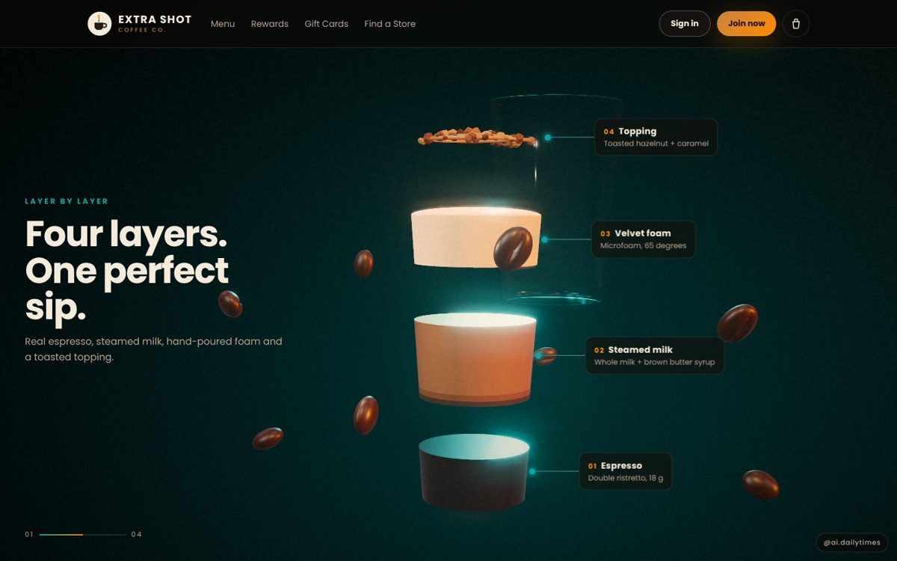
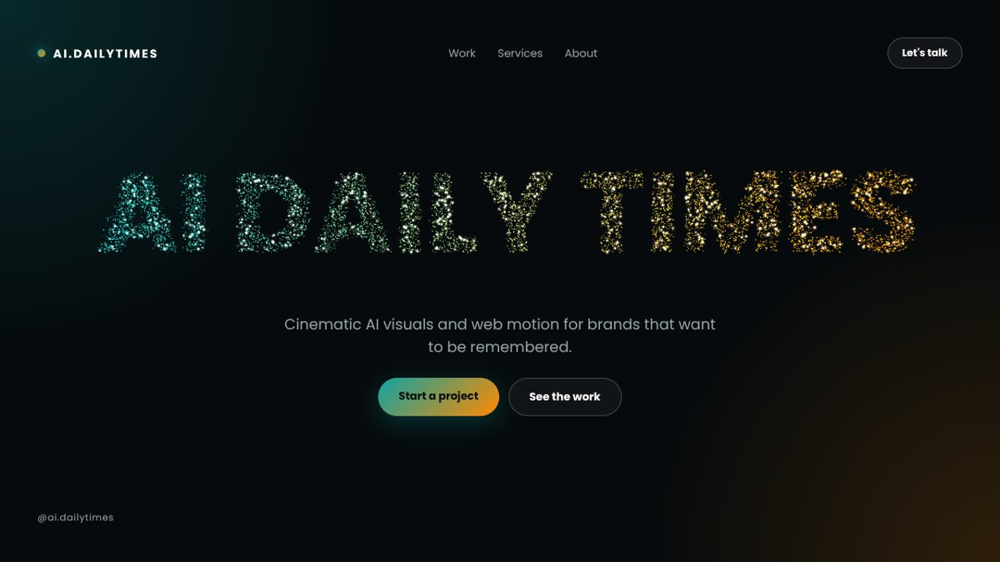
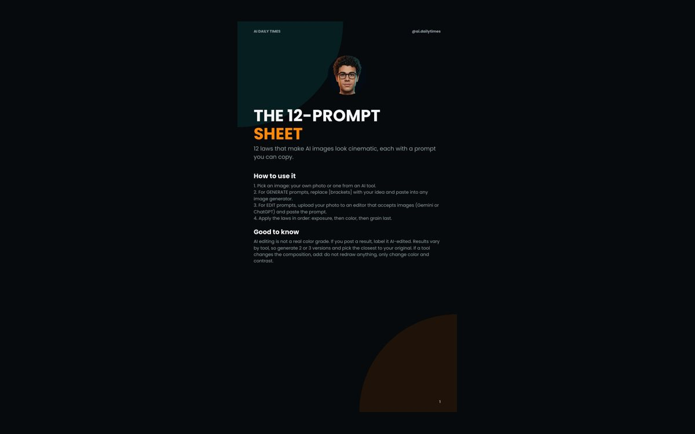

<p align="center">
  
</p>

<h1 align="center">AI Daily Times</h1>

<p align="center">
  <b>AI imagination meets human touch.</b><br>
  AI tools, local AI models, prompts, web design and 3D.
</p>

<p align="center">
  Designed &amp; developed by <b>Ahmed Abdulghany</b>
</p>

<p align="center">
  <a href="https://www.instagram.com/ai.dailytimes/">Instagram</a> ·
  <a href="https://www.tiktok.com/@ai.dailytimes">TikTok</a> ·
  <a href="https://www.youtube.com/@ai.dailytimes">YouTube</a> ·
  <a href="mailto:info.aidailytimes@gmail.com">Email</a>
</p>

<p align="center">
  🌐 <b><a href="https://ahmedabdulghany7.github.io/ai-daily-times/">Open the live gallery</a></b>
</p>

---

## What is this?

This is the home of every free project from my posts. When you comment a keyword on a reel or carousel, the link I send you points here.

Most web projects are **one single HTML file**: no install, no build step, works offline. Open it, change the `CONFIG` at the top, and it is yours.

## Projects

### 🌐 Web & 3D

| Project | What it is | Live | Folder |
|---|---|---|---|
| ☕ **Extra Shot** | Fictional coffee brand: Before 2D vs After 3D | [Compare](https://ahmedabdulghany7.github.io/ai-daily-times/web/coffee/) | [`web/coffee`](web/coffee) |
| ✨ **Particle Hero** | Particles swarm into your brand name | [Demo](https://ahmedabdulghany7.github.io/ai-daily-times/web/hero/) | [`web/hero`](web/hero) |

### 🎬 Prompts

| Project | What it is | Open | Folder |
|---|---|---|---|
| **12 Laws of Cinematic AI Images** | One copy-paste prompt per law + a bonus master grade | [PDF](prompts/cinematic-ai-images/12-prompt-sheet.pdf) | [`prompts/cinematic-ai-images`](prompts/cinematic-ai-images) |

### 🤖 AI & Local Models

Coming soon: local AI setups, model tests and tools you can run on your own machine. See [`ai`](ai).

---

### ☕ Extra Shot: Before 2D vs After 3D



The same coffee brand, built twice with the same content.

- **[Before 2D](https://ahmedabdulghany7.github.io/ai-daily-times/web/coffee/before-2d.html):** a clean, conventional coffee chain site (menu, customizer, cart, rewards, stores, gift cards)
- **[After 3D](https://ahmedabdulghany7.github.io/ai-daily-times/web/coffee/after-3d.html):** real 3D glass cup with steam and beans, scroll story where the layers split, live 3D drink builder, menu cards with depth, rewards jar, 3D city store map
- **[Recording mode](https://ahmedabdulghany7.github.io/ai-daily-times/web/coffee/after-3d.html?record=1):** a 15 second showcase in a 9:16 frame, ready to screen-record for Reels



### ✨ Particle Hero



- Particles form your brand name in 3D; move the cursor to push them, click to blast
- Brand name, colors, buttons and links in one `CONFIG` block
- `?ui=0` shows only the particles (clean for recording)

### 🎬 12 Laws of Cinematic AI Images



A phone-friendly PDF with one copy-paste prompt for each law, plus a bonus master grade prompt.

---

## Repo structure

```
ai-daily-times/
├── index.html                 live gallery
├── web/
│   ├── coffee/
│   │   ├── index.html         Before 2D vs After 3D
│   │   ├── before-2d.html
│   │   └── after-3d.html
│   └── hero/index.html
├── prompts/
│   └── cinematic-ai-images/12-prompt-sheet.pdf
├── ai/                        AI & local models (coming soon)
└── assets/                    previews
```

## How to use a web project

1. Open the file on GitHub and press **Download raw file**.
2. Double-click it. It opens in your browser.
3. Open it in any text editor, change the `CONFIG` object at the top, save, refresh.

## Work with me

I design and build hero sections, 3D websites, UI/UX concepts and cinematic visuals for cafés, restaurants, shops and small brands.
DM **"PROJECT"** on [Instagram @ai.dailytimes](https://www.instagram.com/ai.dailytimes/) or email **info.aidailytimes@gmail.com**.

If something here helped you, a ⭐ on the repo means a lot.

## License

© Ahmed Abdulghany (@ai.dailytimes). Free for personal and commercial use. Credit is appreciated, not required.
Extra Shot is a fictional brand. three.js is included under its MIT license.
